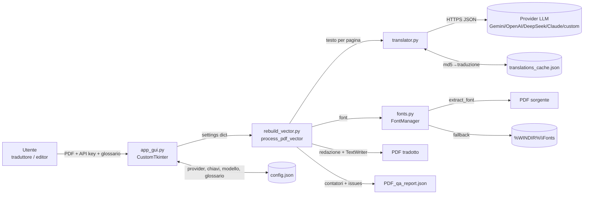
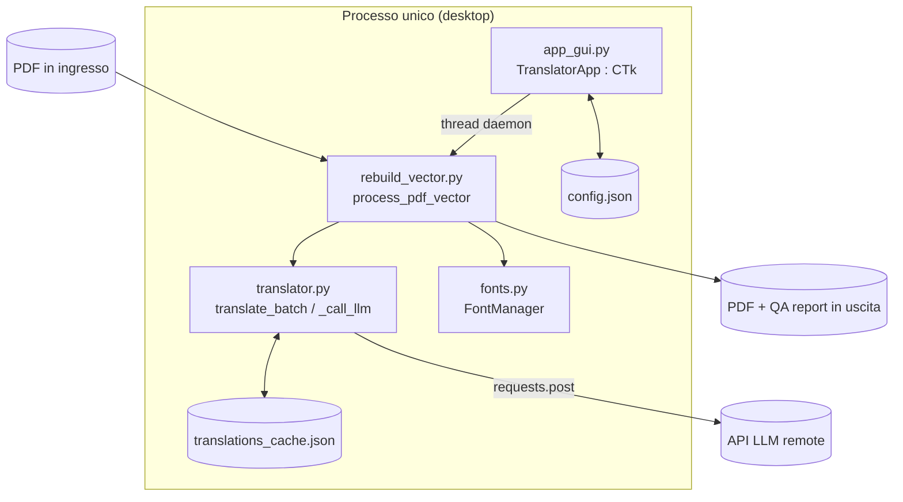
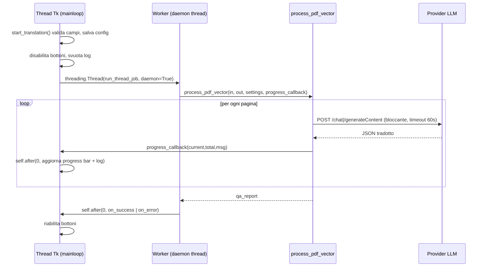
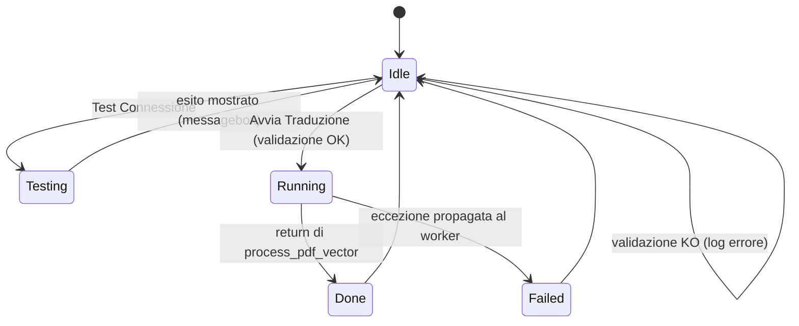

# Architettura di Gen 2

> Parte dell'architettura: indice in [`README.md`](README.md). Sezioni 5.
> Regole vincolanti: [`AGENTS.md`](../../AGENTS.md).

---

## 5. Architettura di Gen 2 (prodotto attuale)

### 5.1 Diagramma di contesto

### 5.2 Diagramma dei container/moduli

### 5.3 Responsabilità dei moduli

| Modulo | Responsabilità | Dipendenze interne | Dipendenze esterne |
|---|---|---|---|
| `app_gui.py` | Configurazione, validazione input, orchestrazione thread, progress, log, test connessione, persistenza `config.json` | `rebuild_vector.process_pdf_vector`, `translator.DEFAULT_MODELS/test_api_connection/fetch_available_models` | customtkinter, tkinter |
| `rebuild_vector.py` | Estrazione layout, batching per pagina, redazione, fitting tipografico, allineamenti, shift verticale, QA report, salvataggio | `translator.*`, `fonts.FontManager` | PyMuPDF, pyphen |
| `translator.py` | Adapter per 5 provider, prompt engineering, parsing JSON robusto, cache, ritraduzione compressa, test connessione, discovery modelli | — | requests, hashlib |
| `fonts.py` | Estrazione font embedded, matching fuzzy, verifica copertura glifi, fallback di sistema, metriche `text_length` | — | PyMuPDF, filesystem Windows |

**Accoppiamento**: `rebuild_vector` importa funzioni a livello di modulo da `translator` (`from translator import translate_batch, …`) e da `fonts`. Non esiste interfaccia/iniezione: il test offline (`test_vector_run.py`) è costretto a **monkeypatchare** `translator.translate_batch` e `rebuild_vector.translate_batch` per funzionare senza API key. È il segnale classico di assenza di un seam di architettura.

### 5.4 Modello di concorrenza

Punti di merito: il thread worker è `daemon`, la UI non viene toccata da thread secondari (tutto passa da `self.after`), il callback di progresso è dichiarato thread-safe (`update_progress_safe`, `app_gui.py:286`).

Punti di debolezza: **nessuna parallelizzazione** delle chiamate LLM (una pagina per volta, sequenziale), nessuna cancellazione (`start_translation` non espone "Annulla"), nessun timeout globale, nessuna politica di retry/backoff, e un errore su una pagina interrompe l'intero documento (§11).

### 5.5 Stato dell'applicazione (macchina a stati implicita)

Lo stato non è modellato esplicitamente (nessun `enum`, nessun `state` object): è codificato tramite `state="disabled"` dei widget.

---
