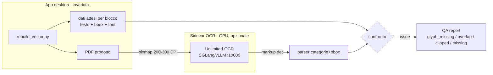

# Integrazione Unlimited-OCR

> Parte dell'architettura: indice in [`README.md`](README.md). Sezioni 14.
> Regole vincolanti: [`AGENTS.md`](../../AGENTS.md).

---

## 14. Valutazione dell'integrazione di Unlimited-OCR (VLM end-to-end)

Analisi condotta sul progetto [baidu/Unlimited-OCR](https://github.com/baidu/Unlimited-OCR) e sui dati reali del repository, per rispondere a una domanda precisa: *questo modello può migliorare la nostra pipeline?*

### 14.1 Scheda tecnica (fatti verificati)

| Dato | Valore | Fonte |
|---|---|---|
| Base architetturale | DeepSeek-OCR + **R-SWA** (Reference Sliding Window Attention) | abstract arXiv 2606.23050 |
| Proprietà chiave | **KV cache costante** per tutta la decodifica → nessun degrado con l'allungarsi della sequenza | abstract |
| Capacità | trascrive **decine di pagine in un singolo forward pass** entro `max_length=32768` | abstract + README |
| Pesi | **3.336.106.240 parametri BF16** (≈3,34 B), storage 6,77 GB | API HuggingFace del modello |
| Decoder | MoE stile DeepSeek-V2 (`num_experts_per_tok: 6`) | `config.json` del modello |
| Formato output | markup con **categoria + bounding box**: `<\|det\|>tipo [x1,y1,x2,y2]<\|/det\|>contenuto` | README, sezione post-processing OmniDocBench |
| Deployment | transformers, **vLLM**, **SGLang con API OpenAI-compatible**, Baidu Cloud, HF Spaces | README |
| Requisiti | GPU NVIDIA, CUDA 12.9/13.0, `torch 2.10`, `transformers 4.57`, `pymupdf` | README (env testato: Python 3.12.3) |
| Licenza | **MIT** | model card |
| Varianti leggere | esistono port GGUF/quantizzati della community | HF (spaces `epiCodex/UnlimitedOCR-GGUF`) |

### 14.2 Verdetto per caso d'uso

| Uso ipotetico | Giudizio | Motivazione |
|---|---|---|
| Sostituire `page.get_text('dict')` sui PDF **nativi** | ❌ **No** | Da un raster si ricava testo + box, non **font, size, color, spans, baseline**: cioè l'intero fondamento di `fonts.py` e `fit_font` (§7.1-7.2). Perdita netta di fedeltà, in cambio di un costo GPU. |
| **Oracolo di QA visivo** sul PDF prodotto | ✅ **Sì — valore massimo, rischio minimo** | Verifica i pixel, non le intenzioni: rileva ciò che i contatori attuali (`font_reduced`, `overflow_shifted`) non vedono. |
| Sbloccare PDF **scansionati / pagine ibride** | ✅ Sì, nuova capability | Oggi il caso è un errore esplicito (`ValueError: il PDF non contiene testo selezionabile`). |
| Segmentazione semantica (tabelle, colonne, reading order) | ⚠️ Possibile ma sproporzionato | Per il **solo** layout detection esistono modelli ~100× più leggeri (PP-DocLayout, DocLayout-YOLO); un VLM da 3,34 B è sovradimensionato. |

### 14.3 Perché serve: difetti misurati sui nostri artefatti

Misure eseguite con PyMuPDF sugli output già prodotti (nessuna stima).

**(a) Sovrapposizioni geometriche** — coppie di blocchi di testo la cui intersezione supera il 25% dell'area del blocco minore e 20 pt²:

| Artefatto | Pagine | Blocchi | **Coppie sovrapposte critiche** |
|---|---|---|---|
| `Agile-estimating-and-planning- Mike Cohn-ITALIANO2.pdf` | 365 | 6.551 | **102** |
| `User-story-mapping-…-ITALIANO4.pdf` | 324 | 2.986 | **69** |

Esempi reali (bbox in punti PDF):

- Cohn p35: `[134.8, 420.3, 219.1, 429.2]` × `[72.8, 420.3, 236.0, 448.4]` → sovrapposizione 752,8 pt²
- Patton p245: `[75.6, 423.8, 207.3, 477.4]` × `[75.6, 435.9, 362.4, 526.6]` → sovrapposizione 5.456,4 pt²

Nota metodologica: una parte di questi casi è un falso positivo dovuto al fatto che il `bbox` di un blocco multi-colonna è l'unione delle righe; il QA geometrico va quindi raffinato a livello di **riga** prima di usarlo come metrica ufficiale.

**(b) Sostituzione silenziosa di caratteri tipografici** — il difetto più istruttivo emerso dall'analisi:

| Sorgente | Em-dash `—` (U+2014) | `·` (U+00B7) |
|---|---|---|
| Dati tradotti Gen 1 (`translations.json`) | 301 | 0 |
| Cache Gen 2 (`translations_cache.json`) | 439 | 0 |
| Output `Cohn-ITALIANO2.pdf` | 175 ✔ | 0 |
| Output `Patton-ITALIANO4.pdf` | **0** ❌ | **112** ❌ |

Interpretazione: dove il renderer usa `fitz.TextWriter` con un oggetto `fitz.Font` reale (font embedded o TTF di sistema — il percorso della Gen 2) i caratteri speciali **sopravvivono**; dove usa le API base-14 (`insert_text` / `insert_textbox` con `fontname='helv'`, tipiche dei renderer Gen 1) vengono **sostituiti**. La sostituzione dipende dall'API, non dal font (esperimento riproducibile: i quattro PDF di prova sono conservati nell'archivio locale `Documents/LitteraLit-archivio/test-output/`):

| Percorso di rendering | `—` | `–` | `’` | Verdetto |
|---|---|---|---|---|
| `insert_textbox(..., fontname='helv')` (Gen 1: `rebuild_v8/v9`) | `?` | `?` | `?` | ❌ sostituzione silenziosa |
| `insert_text(..., fontname='helv')` (Gen 1: `rebuild_final`, fallback) | `·` | `·` | `·` | ❌ sostituzione silenziosa |
| `fitz.TextWriter` + `fitz.Font('helv')` | `—` ✔ | `–` ✔ | `’` ✔ | ✅ corretto |
| `fitz.TextWriter` + `fitz.Font(arial.ttf)` | `—` ✔ | `–` ✔ | `’` ✔ | ✅ corretto (con NBSP) |

Conseguenze architetturali:

- il difetto è **strutturale nella Gen 1** ed è la spiegazione dei 112 `·` in `ITALIANO4.pdf`;
- nella Gen 2 il percorso sicuro è quello ordinario (`tw.write_text`), quindi il rischio è **residuo** e confinato al fallback di eccezione `insert_text(..., 'helv')` (`rebuild_vector.py:556,669`) e all'ultima spiaggia di `fonts.py` (`fitz.Font('helv')`);
- il fallback «in caso di errore disegno la riga con un font base-14» è quindi una **trappola silenziosa**: meglio saltare la riga e registrare una issue nel QA report che pubblicare punteggiatura corrotta.

Il difetto è **silenzioso**: nessuna eccezione, nessun `?` visibile, nessun contatore nel QA report. È la prova concreta che il QA attuale misura *quanto il layout ha ceduto*, non *cosa si vede davvero* sulla pagina.

**(c) Verifica delle pagine "senza testo"** (per capire se serve l'OCR):

| Libro | Pagine senza text layer | Natura verificata |
|---|---|---|
| Patton | 15 (p6, 18, 22, 82, 96, 112, 134, 176, 212, 226, 284, 292, 304, 306, 310) | **pagine bianche**: 0 testo, 0 immagini, 0 disegni |
| Cohn | 2 (p1, p362) | copertine: 1 immagine, 0 testo |

Conclusione: **nessuno dei due libri attuali ha bisogno dell'OCR**; il percorso scansionati è una capability nuova, non una correzione.

### 14.4 Architettura di integrazione proposta

**Regole di integrazione**

1. **Sidecar, mai nel binario**: `torch` + 6,77 GB di pesi sono incompatibili con l'`.exe` onefile da 42,2 MB. Il modello vive in Docker/SGLang; l'app resta leggera e lo chiama via HTTP.
2. **Adapter separato**: `translator._call_llm` è text-only e `robust_json_parse` non è adatto a un output a marcatori → nuovo modulo (es. `ocr_client.py`) con parser dedicato a `<\|det\|>tipo [bbox]<\|/det\|>`, e corretta **denormalizzazione** delle coordinate dal DPI di rendering ai punti PDF.
3. **Formatore di scambio allineato al nostro modello dati**:

| Campo OCR | Nostro equivalente |
|---|---|
| categoria (`text`/`title`/`table`/`image`) | `block['type']` / euristica TOC (§6.2) |
| `[x1,y1,x2,y2]` | `block['bbox']` in punti PDF |
| contenuto | `line_texts` / `full_text` del blocco |

4. **Strategia "text layer first, OCR on demand"**: niente OCR su tutto il libro, solo se (i) `page.get_text().strip() == ""`, oppure (ii) il *round-trip check* fallisce (testo estratto dall'output ≠ testo atteso — è il caso em-dash), oppure (iii) richiesta esplicita dell'utente su pagina sospetta.
5. **Una pagina per richiesta** (`image_mode=base`, una sola immagine): l'one-shot multi-pagina è ottimo per il throughput ma un errore precoce contamina le pagine successive e rende impossibile l'attribuzione del difetto. Per il QA serve isolamento, non velocità.
6. **Determinismo**: `temperature=0` + custom logit processor riducono la varianza, ma un MoE non è bit-deterministico → il QA deve usare soglie/robustezza, non uguaglianza stretta.

**Nuove issue per il QA report** (stesso schema JSON, §6.9):

| Issue | Come si rileva | Serve GPU? |
|---|---|---|
| `glyph_missing` | token-diff tra testo atteso (dai nostri dati) e testo estratto dal PDF prodotto | ❌ no |
| `text_overlap` | intersezioni tra bbox di **riga** > soglia | ❌ no |
| `clipped` | testo OCR fuori dalla bbox prevista (IoU basso) o oltre il bordo pagina | ✅ sì |
| `text_missing` | blocco previsto senza testo OCR corrispondente | ✅ sì |
| `scan_fallback` | pagina priva di text layer tradotta dal percorso OCR | ❌ no |

### 14.5 Cosa NON risolve

Il collo di bottiglia del progetto **non è l'estrazione del testo** (i libri attuali hanno text layer eccellente: 4.207 e 2.742 blocchi, zero pagine problematiche — §14.3c). Restano fuori dal perimetro OCR:

1. **Reflow**: font ridotti nel 48,6% dei blocchi, shift verticale nel 26% (§10.1) — nessun OCR interviene.
2. **Ingegnerizzazione**: retry/backoff, checkpoint/resume, cache a chiave composta, test, segreti (§11) — nessun OCR interviene.
3. **Conservazione degli stili inline** (bold/italic/apici) — richiede spans, che l'OCR non fornisce.
4. **Qualità della traduzione**: l'OCR verifica il *rendering*, non la correttezza linguistica.

Per il supporto scansioni, prima di un VLM da 3,34 B andrebbero valutate opzioni CPU molto più economiche: `ocrmypdf` + Tesseract (produce un text layer che **entra nella pipeline esistente senza modifiche**) e, per il layout, modelli dedicati (PP-DocLayout, DocLayout-YOLO) o pipeline document-AI già complete (Docling, Marker).

### 14.6 Piano sperimentale e criteri di adozione

Campione: 20 pagine (10 Patton dense di figure + 10 Cohn con tabelle e indice).

| Modalità | Estrazione |
|---|---|
| **A** | text layer PyMuPDF (baseline attuale) |
| **B** | Unlimited-OCR, una pagina per richiesta, 300 DPI |
| **C** | ibrida: A + OCR solo su anomalie |

Misure: **CER** sul testo inglese rispetto a `page.get_text()`; **MAE dei bbox** rispetto agli span PyMuPDF; secondi/pagina; VRAM di picco; tasso di corretta identificazione di tabelle e titoli.

**Criterio di adozione**: OCR usato come estrattore solo se `CER < 1%` **e** `MAE bbox < 2 pt`; altrimenti resta confinato al ruolo di oracolo QA, dove la precisione dei box conta poco perché il riferimento geometrico resta il nostro.

**Costi attesi**: ~10–12 GB VRAM in BF16 (3,34 B parametri + encoder/attivazioni), latenza nell'ordine delle decine di secondi per lotto di pagine su GPU consumer, nessun costo API (modello locale).

### 14.7 Priorità consigliata

| # | Azione | Costo | Guadagno |
|---|---|---|---|
| **0** | QA geometrico (overlap a livello di riga) + **glyph-diff** sul testo estratto dall'output — nessuna GPU | ~1 giorno | cattura i 102 + 69 overlap e il bug em-dash di §14.3b |
| **1** | QA visivo con OCR come oracolo indipendente | 2–3 giorni + GPU | cattura clipping, tofu, testo invisibile, sovrapposizioni reali |
| **2** | Percorso OCR per PDF scansionati (fallback sul `ValueError`) | 3–5 giorni | nuova classe di input |
| **3** | Uso di bbox/categorie per tabelle e multi-colonna | settimane, alta incertezza | solo se arriva un libro che lo richiede |

**Sintesi**: Unlimited-OCR è utile come **strumento di verifica**, non come motore di estrazione. È il pezzo mancante dell'*osservabilità*, non del *layout*: adottarlo al posto di `get_text` sarebbe un arretramento, adottarlo come giudice esterno dei nostri output è un salto di qualità a basso rischio.

---
